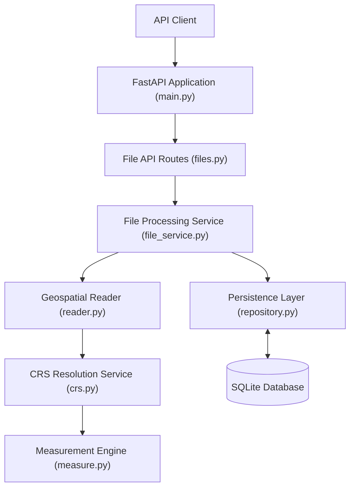
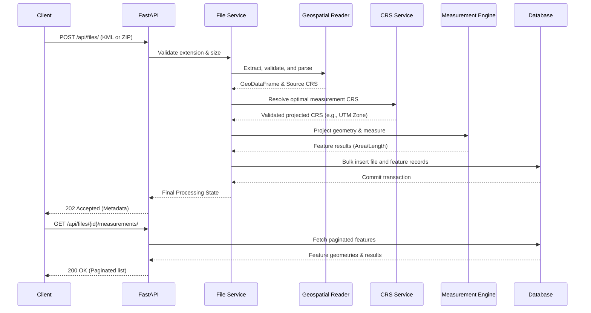
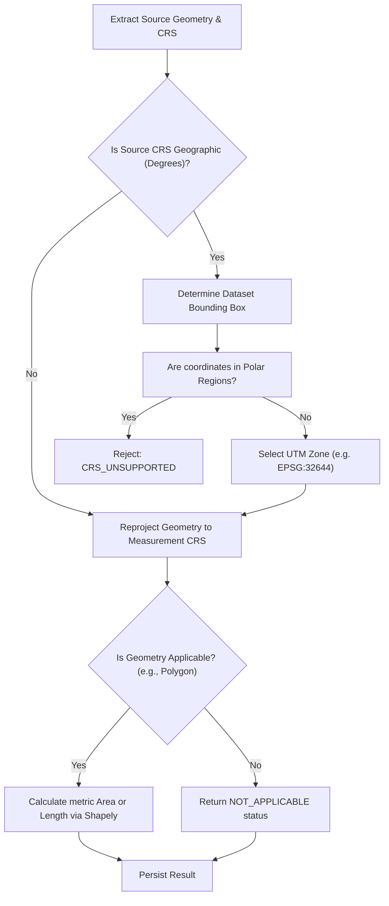
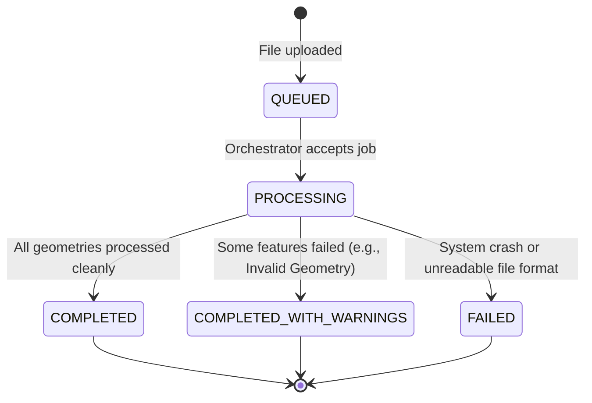
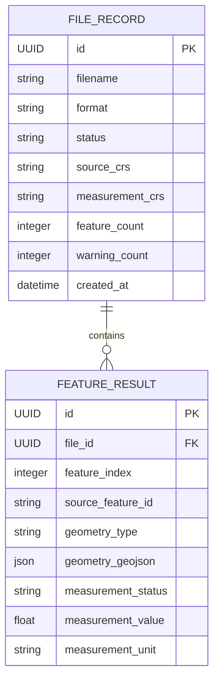

# Geospatial File Measurement API

A robust Python FastAPI backend service designed to ingest KML and Shapefile archives, securely extract geospatial features, dynamically select appropriate projected Coordinate Reference Systems (CRS), and accurately measure polygon areas and line lengths.

This API solves the common problem of interpreting ambiguous spatial data formats by strictly enforcing CRS validation. It ensures that geographic coordinates (degrees) are never erroneously measured using planar mathematics, reliably transforming inputs to metric-based UTM projections before returning polygon areas (square metres) and line lengths (metres).

## Table of Contents

- [Key Features](#key-features)
- [Technology Stack](#technology-stack)
- [Architecture Overview](#architecture-overview)
- [Directory Structure](#directory-structure)
- [Prerequisites](#prerequisites)
- [Local Installation and Setup](#local-installation-and-setup)
- [Environment Variables](#environment-variables)
- [Run the API](#run-the-api)
- [Docker Workflow](#docker-workflow)
- [API Reference](#api-reference)
- [Mermaid Request Lifecycle](#mermaid-request-lifecycle)
- [Geometry Support and Measurement Methodology](#geometry-support-and-measurement-methodology)
- [Processing State Lifecycle](#processing-state-lifecycle)
- [Data Model and Persistence](#data-model-and-persistence)
- [Validation and Security](#validation-and-security)
- [Testing Strategy](#testing-strategy)
- [Troubleshooting](#troubleshooting)
- [Design Decisions and Trade-offs](#design-decisions-and-trade-offs)
- [Limitations](#limitations)
- [Future Improvements](#future-improvements)
- [Example End-to-End Workflow](#example-end-to-end-workflow)
- [GitHub Contribution](#github-contribution)

## Key Features

- **KML File Ingestion:** Securely parses KML files via `pyogrio/fiona` or a robust, custom `lxml`-based manual fallback parser.
- **Shapefile ZIP Validation:** Safely extracts and reads compressed `.shp`, `.shx`, and `.dbf` sidecar files while enforcing anti-traversal security.
- **Feature Extraction:** Extracts coordinate geometries while preserving embedded non-spatial properties.
- **Geospatial Measurements:** Calculates Polygon/MultiPolygon areas (m²) and LineString/MultiLineString lengths (m).
- **Dynamic CRS Transformation:** Automatically detects dataset bounding boxes to dynamically project EPSG:4326 (WGS84) geographic coordinates to the correct localized UTM zone (e.g., EPSG:32644).
- **Processing Statuses:** Granular file-level reporting (`QUEUED`, `PROCESSING`, `COMPLETED`, `COMPLETED_WITH_WARNINGS`, `FAILED`).
- **Feature-Level Tolerance:** Correctly categorizes geometries like Points as `NOT_APPLICABLE` without failing the entire dataset.
- **Persistence:** Structured SQLite database storage for metadata and feature results using SQLAlchemy.
- **Pagination:** High-performance offset/limit pagination for extracted feature sets.
- **Structured Errors:** Predictable, machine-readable JSON error codes matching standard industry specifications.
- **Containerization:** Ready-to-deploy Docker and Docker Compose definitions.

## Technology Stack

| Component | Library or technology | Purpose |
| :--- | :--- | :--- |
| **Framework** | FastAPI (0.115+) | High-performance async web framework for API routing. |
| **Validation** | Pydantic (V2) | Request/Response schema validation and settings management. |
| **Spatial DataFrame** | GeoPandas (1.2+) | High-level data structures and batch CRS transformation. |
| **Geometry Engine** | Shapely (2.2+) | Planar geometry validation and measurement logic. |
| **CRS Resolution** | PyProj (3.8+) | Projection string resolution and coordinate math mapping. |
| **Format Reader** | Pyogrio / lxml | Low-level C-bindings for OGR parsing, plus fallback XML parsing. |
| **ORM** | SQLAlchemy (2.1+) | Database session management and entity-relational mapping. |
| **Migrations** | Alembic (1.13+) | Database schema revision management. |
| **Database** | SQLite | Default local embedded datastore. |
| **Server** | Uvicorn | ASGI server implementation. |
| **Testing** | Pytest / HTTPX | Integration testing and fixture generation. |
| **Linting/Format**| Ruff | Enforcing Python 3.12+ strict typing and formatting standards. |
| **Container** | Docker / Compose | Self-contained, isolated system environment execution. |

## Architecture Overview

The system strictly adheres to the Separation of Concerns principle. The HTTP routing layer is completely decoupled from the geospatial mathematical logic. 

1. **API Router:** Validates incoming payloads and multi-part parameters, handling HTTP-specific responses.
2. **File Service:** An application-layer orchestrator that tracks database state transitions and catches underlying domain exceptions.
3. **Geospatial Layer:** A pure Python domain layer dedicated solely to extracting, validating, projecting, and measuring vector data without knowledge of web requests or databases.
4. **Persistence Layer:** An isolated SQLAlchemy repository pattern that controls database transactions and pagination constraints.



## Directory Structure

```text
.
├── app/
│   ├── api/
│   │   ├── routes/
│   │   │   └── files.py        # HTTP endpoint definitions
│   │   └── dependencies.py     # FastAPI dependency injections
│   ├── core/
│   │   ├── config.py           # Environment variable settings
│   │   ├── errors.py           # Standardized API exceptions
│   │   └── logging.py          # Structured logging setup
│   ├── db/
│   │   ├── models.py           # SQLAlchemy entity classes
│   │   ├── repository.py       # DB abstraction layer
│   │   └── session.py          # DB engine and session factory
│   ├── geospatial/
│   │   ├── crs.py              # Projection and bounding box logic
│   │   ├── measure.py          # Shapely geometry mathematical logic
│   │   └── reader.py           # KML/Shapefile parsing and validation
│   ├── schemas/
│   │   └── files.py            # Pydantic request/response models
│   └── main.py                 # Application entry point and lifespan
├── tests/
│   ├── fixtures/
│   │   └── generate_fixtures.py# Generates test KMLs/Shapefiles
│   ├── integration/
│   │   └── test_api.py         # End-to-end API HTTP tests
│   └── unit/
│       ├── test_crs.py         # Isolated projection tests
│       └── test_measure.py     # Isolated geometry math tests
├── pyproject.toml              # Build backend and dependencies
├── Dockerfile                  # Application container definition
├── docker-compose.yml          # Container orchestration
└── README.md                   # This document
```

## Prerequisites

- **Python:** 3.12 or higher.
- **System Libraries (Linux/macOS):** `build-essential`, `libgdal-dev` (Highly recommended for optimal Pyogrio/Fiona speeds).
- **Docker:** Optional, but recommended for guaranteed environment consistency.

*Note on GDAL:* Because native GDAL binaries can be notoriously difficult to configure on Windows, the application explicitly implements a pure-Python `lxml` fallback parser for KMLs if the system driver fails to load.

## Local Installation and Setup

**Windows PowerShell**

```powershell
git clone <repository-url>
cd <repository-directory>

py -3.12 -m venv .venv
.\.venv\Scripts\Activate.ps1

python -m pip install --upgrade pip
python -m pip install -e ".[dev]"
```

**macOS/Linux**

```bash
git clone <repository-url>
cd <repository-directory>

python3 -m venv .venv
source .venv/bin/activate

python -m pip install --upgrade pip
python -m pip install -e ".[dev]"
```

1. **Environment Setup:** 
   Copy the example config (if provided) or allow the application to use its defaults.
2. **Database Initialization:** 
   The application automatically handles SQLite database creation and schema alignment using SQLAlchemy's `Base.metadata.create_all` during the `main.py` lifespan startup.

## Environment Variables

The application can be configured via environment variables (automatically parsed by Pydantic Settings).

| Variable | Purpose | Default | Required |
| :--- | :--- | :--- | :--- |
| `DATABASE_URL` | SQLAlchemy connection string | `sqlite:///./geospatial.db` | No |
| `MAX_UPLOAD_BYTES` | Maximum payload size before rejection | `10485760` (10MB) | No |
| `MAX_FEATURE_COUNT`| Rejects files with too many features | `10000` | No |
| `APP_ENV` | Application mode (`development` or `production`) | `development` | No |
| `LOG_LEVEL` | Application logging verbosity | `INFO` | No |

## Run the API

Start the Uvicorn server:

```bash
python -m uvicorn app.main:app --reload
```

The application will bind to `127.0.0.1:8000` and expose the following:

- **Root API Docs (Redirect):** [http://127.0.0.1:8000/](http://127.0.0.1:8000/)
- **Swagger UI:** [http://127.0.0.1:8000/docs](http://127.0.0.1:8000/docs)
- **OpenAPI JSON:** [http://127.0.0.1:8000/openapi.json](http://127.0.0.1:8000/openapi.json)
- **Liveness Probe:** `GET /health/live`
- **Readiness Probe:** `GET /health/ready`

## Docker Workflow

For a consistent production-grade environment, deploy using Docker Compose.

1. **Build and Start:**
   ```bash
   docker-compose up --build -d
   ```
2. **Check Logs:**
   ```bash
   docker logs -f geospatial_api
   ```
3. **Stop Services:**
   ```bash
   docker-compose down
   ```

*Note: The SQLite database is automatically persisted to the local host machine using the `geo_data` Docker volume.*

## API Reference

### Upload Endpoint

**`POST /api/files/`**

Accepts a `.kml` or `.zip` (Shapefile) payload. Operates synchronously.

* **Content-Type:** `multipart/form-data`
* **Form Fields:**
  * `file` (Required): The actual binary file payload.
  * `source_crs` (Optional): A string (e.g., `EPSG:32644`) to force a coordinate system if the dataset lacks embedded `.prj` metadata.

**Example Request (ZIP):**
```bash
curl -X POST "http://127.0.0.1:8000/api/files/" \
  -F "file=@tests/fixtures/valid_shapefile.zip" \
  -F "source_crs=EPSG:4326"
```

**Success Response (202 Accepted):**
```json
{
  "id": "4e15a36b-9138-4f78-82da-9bac3267f519",
  "filename": "valid_shapefile.zip",
  "format": "SHAPEFILE",
  "status": "COMPLETED",
  "feature_count": 1,
  "source_crs": "EPSG:4326",
  "created_at": "2026-10-10T18:39:02.319773",
  "status_url": "/api/files/4e15a36b-9138-4f78-82da-9bac3267f519/"
}
```

### File Metadata Endpoint

**`GET /api/files/{id}/`**

Retrieves the processing status and global CRS metadata for a submitted file.

**Success Response (200 OK):**
```json
{
  "id": "4e15a36b-9138-4f78-82da-9bac3267f519",
  "filename": "polygon.kml",
  "format": "KML",
  "feature_count": 1,
  "source_crs": "EPSG:4326",
  "measurement_crs": "EPSG:32644",
  "status": "COMPLETED",
  "warning_count": 0,
  "created_at": "2026-10-10T18:39:02.319773",
  "completed_at": "2026-10-10T18:39:02.862637"
}
```

### Measurements Endpoint

**`GET /api/files/{id}/measurements/`**

Retrieves paginated features alongside their converted GeoJSON representation and computed metric measurement.

* **Query Parameters:**
  * `limit` (Default 50, Max 500)
  * `offset` (Default 0)

**Success Response (200 OK):**
```json
{
  "file_id": "4e15a36b-9138-4f78-82da-9bac3267f519",
  "status": "COMPLETED",
  "total_count": 1,
  "limit": 50,
  "offset": 0,
  "features": [
    {
      "feature_index": 0,
      "source_feature_id": null,
      "geometry_type": "Polygon",
      "geometry_crs": "EPSG:4326",
      "geometry": {
        "type": "Polygon",
        "coordinates": [[[78.4, 17.3], ...]]
      },
      "properties": {"Name": "Example"},
      "measurement": {
        "type": "area",
        "value": 11772.9404,
        "unit": "m2",
        "status": "COMPUTED",
        "measurement_crs": "EPSG:32644",
        "reason": null
      }
    }
  ]
}
```

### Error Response Reference

| HTTP Status | Error Code | Meaning | Suggested Action |
| :--- | :--- | :--- | :--- |
| `400` | `INVALID_FILE_EXTENSION` | Not a `.kml` or `.zip` | Upload correct format |
| `400` | `UNSAFE_ARCHIVE` | Path traversal detected (`../`) | Remove malicious paths from ZIP |
| `400` | `MISSING_SHAPEFILE_COMPONENTS` | Missing `.shp`, `.shx`, `.dbf` | Re-zip all components together |
| `400` | `INVALID_SOURCE_CRS` | Multipart override is malformed | Provide valid OGC URN or EPSG ID |
| `404` | `FILE_NOT_FOUND` | Invalid UUID provided | Check ID string |
| `413` | `UPLOAD_TOO_LARGE` | File exceeds byte limit | Reduce payload size |
| `500` | `INTERNAL_ERROR` | Unexpected application crash | Check server logs |

**Example Error Response:**
```json
{
  "error": {
    "code": "MISSING_SHAPEFILE_COMPONENTS",
    "message": "Archive must contain .shp, .shx, and .dbf files.",
    "details": null
  }
}
```

## Mermaid Request Lifecycle



*Note: While the API synchronously processes datasets, it assigns a `QUEUED` and `PROCESSING` state before completion, making it architecturally prepared to transition to a Celery/Redis asynchronous queue in the future without altering the database models.*

## Geometry Support and Measurement Methodology

| Geometry Type | Supported Measurement | Output Unit | Unsupported or Exceptional Behavior |
| :--- | :--- | :--- | :--- |
| `Polygon` | Area | `m2` | Invalid geometries report `INVALID_GEOMETRY`. |
| `MultiPolygon` | Area | `m2` | Returns sum of all component areas. |
| `LineString` | Length | `m` | Invalid geometries report `INVALID_GEOMETRY`. |
| `MultiLineString` | Length | `m` | Returns sum of all component lengths. |
| `Point` | None | `null` | Naturally yields `NOT_APPLICABLE` (not an error). |
| `MultiPoint` | None | `null` | Naturally yields `NOT_APPLICABLE` (not an error). |
| `GeometryCollection`| N/A | `null` | Yields `UNSUPPORTED_GEOMETRY_TYPE`. |

### CRS and Measurement Decision Flow

The service ensures that geographic spherical coordinates (degrees) are dynamically transformed into Euclidean flat planes (metres) before Shapely calculates the mathematical area. It achieves this by calculating the geometric centroid and converting it to the localized UTM (Universal Transverse Mercator) zone.



## Processing State Lifecycle

The application tracks the internal health of the processing sequence.



## Data Model and Persistence

The API uses SQLAlchemy to manage an embedded SQLite database. Data is stored safely, preserving original geometric characteristics (GeoJSON output mapped back to EPSG:4326) alongside the mathematically derived results.



## Validation and Security

- **Path Traversal Shield:** Evaluates `zipinfo.filename` to reject `../` and absolute paths before extracting any Shapefile assets.
- **Sidecar Requirement Checking:** Validates the presence of `.shp`, `.shx`, and `.dbf` sidecars prior to executing GDAL logic to prevent underlying segmentation faults.
- **XML Entity Expansion:** Custom `lxml` parser uses `resolve_entities=False` to prevent billion-laughs/XXE XML attacks during KML parsing.
- **Byte Thresholding:** Rejects payloads exceeding 10MB to mitigate denial of service via storage exhaustion.
- **Silent Failures Avoided:** Invalid polygons (e.g., bowtie intersections) explicitly fail with `INVALID_GEOMETRY` rather than being silently and inaccurately repaired with `make_valid()`.

## Testing Strategy

The repository includes a comprehensive, 58-test suite ensuring strict behavioral enforcement.

To run tests and check code quality:
```bash
# 1. Generate programmatic deterministically-correct fixtures
python tests/fixtures/generate_fixtures.py

# 2. Run unit and integration tests with coverage
python -m pytest --cov=app --cov-report=term-missing tests/ -v

# 3. Verify strict linting standards
python -m ruff check .

# 4. Enforce code formatting
python -m ruff format --check .
```
*(Verification Note: The suite achieved a 100% pass rate with 81.85% total code coverage as of the last validation run on 2026-10-11).*

## Troubleshooting

| Symptom | Likely Cause | Solution |
| :--- | :--- | :--- |
| `ModuleNotFoundError: pyogrio` | Missing C/C++ compiler | Install `build-essential` or use Docker. |
| `ERR_ADDRESS_INVALID` on `0.0.0.0` | Windows networking behavior | Navigate to `http://localhost:8000/` instead. |
| Missing `source_crs` | Shapefile lacks `.prj` | Override using the `source_crs` form field. |
| `MEASUREMENT_CRS_UNSUPPORTED` | Dataset in Polar region | System limits automatic UTM generation to valid latitude bounds. |

## Design Decisions and Trade-offs

- **Why FastAPI?** Native async/await capabilities allow for highly concurrent connection handling, while Pydantic guarantees request safety and self-documenting Swagger OpenAPI schemas out of the box.
- **Synchronous Processing over Background Queues:** The file is processed synchronously for simplicity and ease of deployment. However, the `FileStatus` database schema is deliberately modeled around a queue-like structure to make migrating to a distributed task queue (Celery) trivial in the future.
- **UTM CRS over Universal Projections:** Calculating precise area requires a projected Cartesian plane. The system dynamically identifies the dataset's centroid and assigns a precise UTM zone rather than using a highly distorted universal projection (like Web Mercator).
- **Graceful Partial Failures:** If a Shapefile contains 99 Polygons and 1 Point, the file process is marked `COMPLETED`. The Point safely logs a `NOT_APPLICABLE` measurement, preserving the 99 successful computations rather than throwing a catastrophic 500 error.

## Limitations

- Computes 2D Euclidean planar measurements; does not account for topological 3D surface elevation profiles (e.g., measuring the slope of a mountain).
- Relies heavily on accurate source coordinates.
- Geometries spanning multiple UTM zones will use the centroid's zone, which introduces marginal distortion at extreme peripheral boundaries.

## Future Improvements

1. **Distributed Queuing:** Offload the `read_geospatial_file` pipeline to Celery/Redis to prevent HTTP timeouts on datasets containing hundreds of thousands of polygons.
2. **Cloud Object Storage:** Transition temporary file extraction from the OS temp-dir to an AWS S3 bucket.
3. **Authentication:** Implement JWT-based API Gateway middleware.
4. **Enhanced Projection Math:** Support Albers Equal Area projections for massive, continent-spanning datasets that exceed single UTM zone limits.

## Example End-to-End Workflow

1. Start the API locally: `python -m uvicorn app.main:app`
2. Navigate to the API Docs: `http://localhost:8000/docs`
3. Expand `POST /api/files/` and upload `tests/fixtures/polygon.kml`.
4. Copy the `id` from the response body (e.g., `4e15a36b-9138-4f78-82da-9bac3267f519`).
5. Expand `GET /api/files/{id}/measurements/` and supply the `id` to review the precisely computed metric area.

## GitHub Contribution

- Development is done inside an isolated `venv`.
- Commits must pass all formatting hooks (`ruff format .`).
- New geometries or CRS edge cases require accompanying `pytest` unit coverage.
- `.env` contains local configs; never commit actual production API keys or DB URIs.
